<p align="center">
  
</p>

<p align="center">
  <a href="README.md"></a>
  <a href="README.sr.md"></a>
</p>

<p align="center">
  
  
  
  
  
  
</p>

<p align="center">
  <b>Strukturisan, praktičan put kroz C++</b> — od prvog <code>Hello, World!</code> programa do objektno-orijentisanog dizajna, STL-a i modernog C++-a.<br>
  Svaka tema ima kratak, čitljiv primer koji možeš da kompajliraš, pokreneš i menjaš.
</p>

<p align="center"></p>

## Sadržaj

- [O projektu](#o-projektu)
- [Za koga je ovo](#za-koga-je-ovo)
- [Plan učenja](#plan-učenja)
- [Početak rada](#početak-rada)
- [Kako učiti uz ovaj repozitorijum](#kako-učiti-uz-ovaj-repozitorijum)
- [Demonstrirane veštine](#demonstrirane-veštine)
- [Pravila repozitorijuma](#pravila-repozitorijuma)
- [Doprinos](#doprinos)
- [Povezani repozitorijumi](#povezani-repozitorijumi)
- [Licenca](#licenca)
- [Autor](#autor)

## O projektu

**C++ Learning Resources** je zbirka C++ primera i vežbi zasnovana na principu „uči radeći“. Teme su raspoređene tako da se svaka naslanja na prethodnu. Fokus je na:

- **Jasnoći** — kratki programi koji prikazuju jednu ideju odjednom.
- **Praksi** — vežbe i mini-projekti, a ne samo teorija.
- **Modernom stilu** — idiomatski C++17/20: RAII, pametni pokazivači, STL i `const`-korektnost umesto ručnog upravljanja memorijom.

## Za koga je ovo

| Publika | Šta dobijaš |
| --- | --- |
| 🎓 **Studenti i početnici** | Postepen, uređen put sa primerima koji se mogu pokrenuti za svaki koncept. |
| 🔁 **Programeri koji prelaze na C++** | Brzo osvežavanje pokazivača, memorije, šablona i STL-a. |
| 💼 **Poslodavci i regruteri** | Transparentan uvid u to kako učim, strukturišem i dokumentujem kod — pogledaj [Demonstrirane veštine](#demonstrirane-veštine). |

## Plan učenja

Materijal prati progresivni plan. Svaka faza se nadovezuje na prethodnu.

| Faza | Fokus | Ključne teme |
| :---: | --- | --- |
| **1** | Osnove | Struktura programa, kompajliranje, promenljive, tipovi, operatori, ulaz/izlaz (`iostream`) |
| **2** | Kontrola toka i funkcije | `if`/`switch`, petlje, funkcije, preklapanje, podrazumevani argumenti, rekurzija |
| **3** | Nizovi, stringovi i pokazivači | C-nizovi, `std::array`, `std::string`, pokazivači, reference, `const` |
| **4** | Objektno-orijentisano programiranje | Klase, konstruktori/destruktori, enkapsulacija, nasleđivanje, polimorfizam, preklapanje operatora |
| **5** | Šabloni i STL | Funkcijski/klasni šabloni, `vector`, `map`, `set`, iteratori, `<algorithm>`, lambde |
| **6** | Upravljanje memorijom | Stek i heap, RAII, `unique_ptr`, `shared_ptr`, pravilo 3/5/0 |
| **7** | Obrada grešaka i fajlovi | Izuzeci, `fstream`, tekstualni/binarni I/O, `std::filesystem` |
| **8** | Strukture podataka i algoritmi | sortiranje i pretraga, složenost... |
| **9** | Moderni C++ i projekti | Move semantika, `auto`, ranges, `std::optional`, CMake, kompletni mini-projekti |

> 💡 Kreni od faze koja odgovara tvom nivou — svaki folder je samostalna celina.

## Početak rada

### Preduslovi

- Kompajler sa podrškom za C++17: **GCC 9+**, **Clang 10+** ili **MSVC 2019+**
- *(Opciono)* **CMake 3.16+**
- *(Opciono)* Editor kao što je **VS Code**, **CLion** ili **Visual Studio**

### Kloniranje

```bash
git clone https://github.com/MIhajloS07/cpp-learning-resources.git
cd cpp-learning-resources
```

### Kompajliranje i pokretanje jednog primera

```bash
# GCC / Clang
g++ -std=c++20 -Wall -Wextra -pedantic main.cpp -o app
./app
```

```bat
:: MSVC (Developer Command Prompt)
cl /std:c++20 /EHsc /W4 main.cpp
main.exe
```

### Build pomoću CMake-a

```bash
cmake -S . -B build
cmake --build build
```

## Kako učiti uz ovaj repozitorijum

1. **Pročitaj** primer i predvidi izlaz pre pokretanja.
2. **Kompajliraj i pokreni** sa uključenim upozorenjima (`-Wall -Wextra`).
3. **Izmeni** ga — namerno ga pokvari, pa popravi.
4. **Napiši ga ponovo** napamet, bez gledanja.
5. **Reši** vežbu na kraju teme, pa pređi na sledeću.

## Demonstrirane veštine

- Osnove jezika: tipovi, kontrola toka, funkcije, reference i pokazivači
- Objektno-orijentisani dizajn: enkapsulacija, nasleđivanje, polimorfizam
- Generičko programiranje: šabloni i Standardna biblioteka šablona (STL)
- Upravljanje resursima: RAII, pametni pokazivači, move semantika
- Algoritmi i strukture podataka uz svest o složenosti
- Čist, dokumentovan i dosledno formatiran kod sa ponovljivim build-om

## Pravila repozitorijuma

- Jedan koncept po folderu, jedan mali program po ideji.
- Kod se kompajlira bez upozorenja sa `-Wall -Wextra`.
- Smisleni nazivi i kratki komentari koji objašnjavaju *zašto*, a ne *šta*.

## Doprinos

Doprinosi, ispravke i novi primeri su dobrodošli.

1. Napravi fork repozitorijuma
2. Napravi granu: `git checkout -b feature/moja-tema`
3. Commit-uj izmene: `git commit -m "Add: moja tema"`
4. Pošalji (push) i otvori Pull Request

Našao/la si grešku? [Otvori issue](https://github.com/MIhajloS07/cpp-learning-resources/issues).

## Povezani repozitorijumi

- 🪟 [**winforms-learning-resources**](https://github.com/MIhajloS07/winforms-learning-resources) — plan učenja za C# Windows Forms

## Licenca

Objavljeno pod licencom koja se nalazi u fajlu [LICENSE](LICENSE).

## Autor

**Mihajlo Stoiljković** — [@MIhajloS07](https://github.com/MIhajloS07)

<p align="center"></p>

<p align="center"><sub>Ako ti ovaj repozitorijum pomaže, ostavi ⭐ — motiviše me da dodajem novi materijal.</sub></p>
